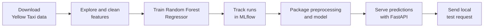

# Model Deployment Project

Use this repository as a **template** for your model deployment project. You will train a regression model that predicts the duration of NYC Yellow Taxi trips, track your experiments locally with MLflow, and serve predictions through a FastAPI app on your own machine. Create pull requests in your own copy even if you are working alone, and use them to track your progress.

## Learning Objectives

By the end of this repository, you should be able to:

- Build an end-to-end regression workflow for real-world taxi trip data.
- Separate exploration, preprocessing, training, and serving concerns into maintainable code.
- Track experiments locally with MLflow and compare model runs.
- Serve model predictions through a local API.

## Learning Path



| File / Folder | Description |
|---|---|
| [**Project Description**](project-description.md) | The assignment tasks, suggested workflow, repository layout, and stretch goals. |
| [**Process Log**](project-processed.md) | Every step taken, with commands, decisions, problems hit and results. |
| [**src/**](src/) | Data loading and cleaning (`data.py`), shared features (`features.py`), model loading (`model.py`), training (`train.py`), Optuna tuning (`tune.py`). |
| [**app/**](app/) | FastAPI app (`main.py`) and request/response schemas (`schemas.py`). |
| [**tests/**](tests/) | 22 pytest tests for the data, features, model and API. |
| [**sample-request.json**](sample-request.json) | An example `/predict` request body. |

### Additional Folders and Files

| File / Folder | Description |
|---|---|
| [**pyproject.toml**](pyproject.toml) | Project configuration, dependencies and pytest settings. |
| [**uv.lock**](uv.lock) | Dependency lock file. |

## Results

### Approach

- **Data:** NYC Yellow Taxi trips from January 2025, 3.48M raw trips.
  - The target is `duration`, meaning dropoff minus pickup, in minutes.
  - Kept: trips of 1–60 min, with distance above 0 and at most 100 miles, picked up in
    January. That leaves **3.34M trips**.
- **Features:** only what is known when a trip starts: pickup and dropoff zones, trip
  distance, passenger count, pickup hour and day of week. Fare, tip and total are
  excluded, because they are only known after the trip and would leak the answer.
- **Split by time:**
  - train on Jan 1–24 (2.54M trips);
  - validate on Jan 25–31 (798k trips).
- **Model:** `RandomForestRegressor`. Runs are tracked in MLflow under the experiment
  `nyc-taxi-duration`.

### Model comparison (validation RMSE on Jan 25–31)

| Model | Training rows | Val RMSE (min) | Model size | Latency per request |
|---|---|---|---|---|
| Always predict the training average | — | 9.589 | — | — |
| Baseline (50 trees, depth 20, min leaf 5) | 500k | 4.105 | 249 MB | 14.6 ms |
| Optuna-tuned (150 trees, depth 26, min leaf 3, max_features 0.5) | 500k | 4.025 | 1,681 MB | 13.3 ms |
| **Baseline settings on all training data (served)** | **2.54M** | **3.958** | 729 MB | 14.7 ms |

**Was tuning worth it?**

- **No.** Optuna ran 25 trials, each scored on Jan 18–24 so the final validation week was
  never used to choose settings.
  - It gained only **2%** (0.08 min per trip).
  - Its model file is **7 times larger**.
  - Its larger gap between training and validation error shows it mostly memorises the
    training trips.
- **Training the plain baseline on all the data did better.** It is 3.6% better than the
  baseline and has less than half the tuned model's file size.
- Trip distance accounts for about 85% of the feature importance, so the amount of data
  and the quality of the features matter more than hyperparameters here.

### Example request

```bash
curl -X POST http://127.0.0.1:8000/predict -H "Content-Type: application/json" -d @sample-request.json
# {"duration_minutes":16.63,"model_version":"rf-20261118135929"}
```

Invalid input, such as `PULocationID: 999`, returns HTTP 422 with a message naming the
field.

### Answers

**1. What is the RMSE of your final model?**

**3.958 minutes** on the held-out final week of January (Jan 25–31, 798,378 trips). The
model is a random forest with 50 trees, max depth 20 and min leaf 5, trained on all
2.54M training trips. For comparison, always predicting the average trip gives 9.589.

**2. What would you do differently if you had more time?**

- **Better features rather than more tuning.** Examples:
  - the pickup→dropoff zone pair, or the average historical duration for that pair;
  - distance between zone centres;
  - holiday, airport and rush-hour flags;
  - weather.
- **Try gradient boosting** (`HistGradientBoostingRegressor` or LightGBM). It is usually
  more accurate on tabular data, trains faster, and produces model files measured in
  megabytes rather than the forest's hundreds of megabytes.
- **Model `log(duration)`.** Long trips dominate RMSE, so it is also worth reporting
  MAE alongside it.
- **Shrink the served model.** At 729 MB it is heavy to ship.
- **Load the model from the MLflow Model Registry** rather than a file path, and package
  the API in Docker.
- **Validate each new month's data** with Great Expectations before retraining, and
  monitor drift (for example February traffic patterns) against the January baseline.

## Setup

Use [uv](https://docs.astral.sh/uv/getting-started/installation/) 0.13.5 or newer
and Python 3.13.17 or a newer 3.13 patch release, as defined in
[`.python-version`](.python-version).

> [!NOTE]
> Throughout these steps, text in angle brackets like `<repo-name>` is a **placeholder**. Replace it, including the `< >` brackets, with your own value. For example, `cd <repo-name>` becomes `cd mle-model-deployment-project`.

### 1. Create the Repository from the Template

Click **Use this template** on GitHub.

When creating the repository:

- Set yourself as the **Owner**
- Choose a repository name
- Disable **Include all branches**
- Click **Create repository**

> [!IMPORTANT]
> If you are working in pairs or groups, only **one person** should complete this step.

---

### 2. Add Collaborators (Pairs/Groups Only)

If working with teammates:

1. Open the repository on GitHub
2. Go to **Settings → Collaborators**
3. Add your teammates as collaborators
4. Share the repository link with your team

Teammates should accept the invitation before continuing.

---

### 3. Clone the Repository

Copy the SSH URL from the **Code** button on GitHub, then run:

```bash
git clone <copied-ssh-url>
```

The copied SSH URL will look like `git@github.com:<your-username>/<repo-name>.git`.

---

### 4. Move into the Project Folder and Install Dependencies

This installs all dependencies and creates a virtual environment in `.venv/`.

```bash
cd <repo-name>
uv sync
```

---

### 5. Open the Repository in VS Code

> [!NOTE]
> Make sure you open VS Code from the project root so it automatically detects the environment created by `uv sync`.

Launch VS Code in the project root folder:

```bash
code .
```

If you create a notebook to explore the data, select the Python environment created by `uv sync` as the kernel.

## How to Use This Repo

1. Read the assignment brief in [project-description.md](project-description.md).
2. Download and inspect the January 2025 Yellow Taxi dataset.
3. Train a baseline `RandomForestRegressor` and track runs locally with MLflow.
4. Refactor preprocessing and training logic into reusable Python modules.
5. Build a local prediction API with FastAPI.
6. Send a test request to the API and document the outcome in your README or PR.

### Working Locally

Once you have implemented the project code, a typical local workflow looks like this:

1. Train the model and log runs to MLflow. Runs are stored in `mlflow.db` and `mlruns/`,
   and the data downloads automatically if it is missing.

   ```bash
   uv run python -m src.train --train-sample 0   # final model: all training rows, saved to artifacts/model.skops
   uv run python -m src.tune --n-trials 25       # optional: Optuna search (~1.5 min)
   uv run pytest -q                              # run the tests
   ```

2. Start the tracking UI:

   ```bash
   uv run mlflow ui --backend-store-uri sqlite:///mlflow.db --port 5000
   ```

3. Run the API locally:

   ```bash
   uv run uvicorn app.main:app --reload --port 8000
   ```

4. Send a request to the API:

   ```bash
   curl -X POST http://127.0.0.1:8000/predict -H "Content-Type: application/json" -d @sample-request.json
   ```

The `app/` package and `sample-request.json` are files you create during the project. Make the sample request match your `/predict` input schema before running the commands above.
